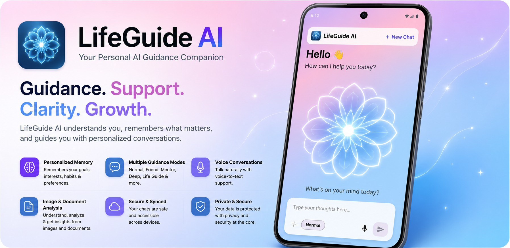

# LifeGuide AI

**Your Personal AI Guidance Companion**

LifeGuide AI is an Android application designed to provide personalized guidance based on your goals, interests, and preferences.

## App Preview

### LifeGuide AI — Overview

### Choose Your Guidance Mode

### Home Screen

## Features

- **Personalized memory** — remembers goals, interests, habits, and preferences.
- **Multiple guidance modes** — Normal, Friend, Mentor, Deep, and Life Guide.
- **Voice conversations** — voice-to-text support for natural conversations.
- **Image and document analysis** — understand and analyze shared images and documents.
- **Synced conversations** — access conversations across devices.

## Get the App

**Google Play Store:**  
https://play.google.com/store/apps/details?id=com.lifeguide.ai&hl=en_SG

Visit the Google Play listing for availability and device compatibility details.

## Technology

- Kotlin
- Android
- AI APIs

## Project Vision

Making personalized guidance more accessible through intelligent and interactive technology.

## Developer

**Konark Anjikar**
