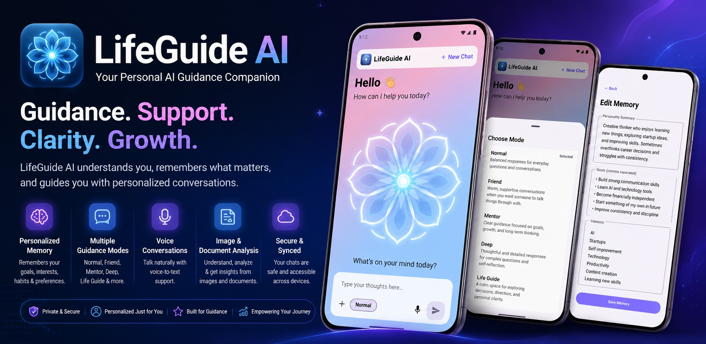
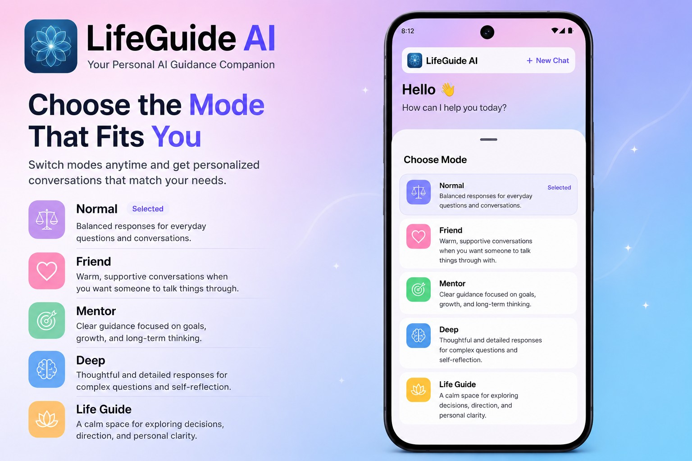

# LifeGuide AI

### Your Personal AI Guidance Companion

LifeGuide AI is an AI-powered Android application designed to make personalized guidance more accessible through interactive conversations based on users' goals, interests, and preferences.

**Published on Google Play**

[**Get LifeGuide AI on Google Play →**](https://play.google.com/store/apps/details?id=com.lifeguide.ai)

---

## App Preview

### LifeGuide AI — Overview

### Choose Your Guidance Mode

### Home Screen

---

## Features

- **Personalized Memory** — Retains useful context about goals, interests, habits, and preferences.
- **Multiple Guidance Modes** — Choose between Normal, Friend, Mentor, Deep, and Life Guide modes.
- **Voice-to-Text Input** — Convert spoken input into text to interact with the AI. This supports voice input, not voice-to-voice conversations.
- **Image and Document Analysis** — Share supported images and documents for AI-powered understanding.
- **Synced Conversations** — Access conversations across supported devices.

## About the Project

LifeGuide AI explores how artificial intelligence can become a more useful everyday companion for learning, reflection, and personal productivity.

The goal is to make AI interactions more contextual, accessible, and personalized.

## Technology

- Kotlin
- Android
- AI APIs

## Project Status

**Published application**

LifeGuide AI is available through Google Play. Visit the store listing for current availability and device compatibility information.

## Repository Information

This repository serves as the public project showcase for LifeGuide AI. It contains project documentation, feature descriptions, and application screenshots. The application's source code is not included in this repository.

## Developer

**Konark Anjikar**

Student Developer | AI & Software

---

[**Explore LifeGuide AI on Google Play →**](https://play.google.com/store/apps/details?id=com.lifeguide.ai)
